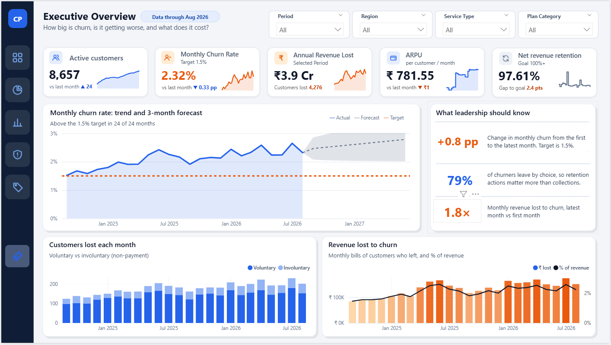
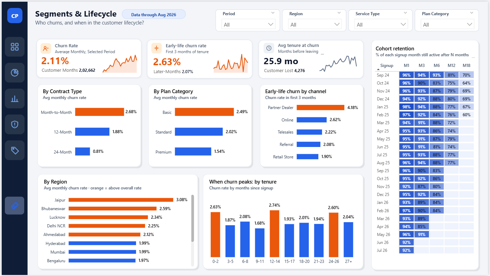
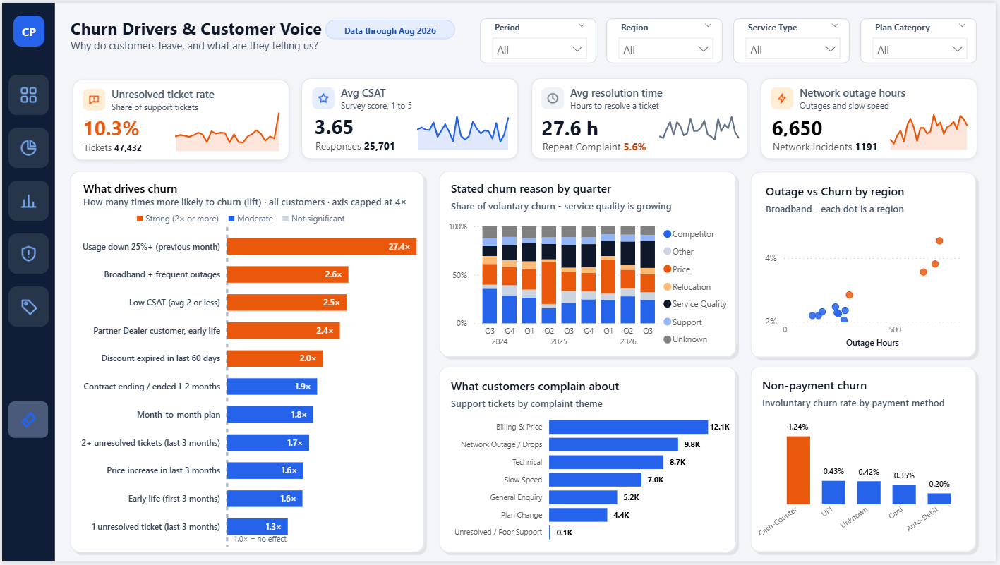
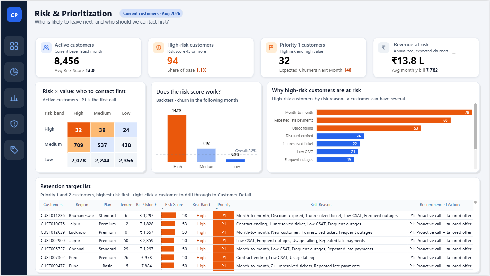
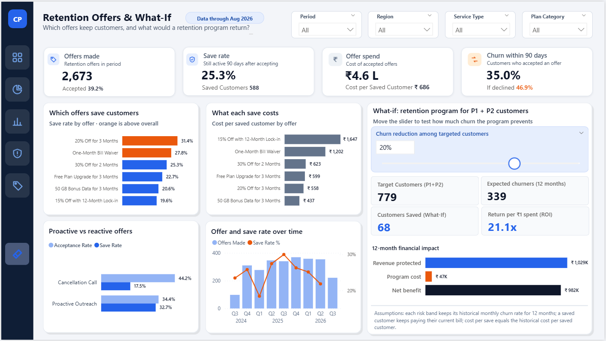
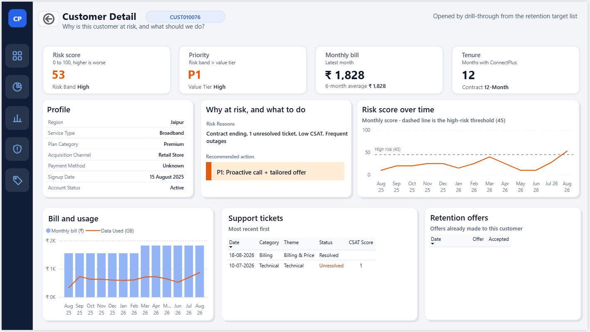

# ConnectPlus · Customer Churn & Retention Analytics

End-to-end analytics project for **ConnectPlus**, a fictional Indian telecom provider (postpaid mobile and broadband). Raw CSV extracts are loaded into **SQL Server**, cleaned and modelled into a star schema, and presented in a 6-page **Power BI** dashboard that shows who leaves, why they leave, who is likely to leave next, and which retention offers are worth paying for.

> **Note:** the dataset is synthetic, built for this portfolio project. The numbers are illustrative; the pipeline and methods are what I would use on real data.

**Tools:** Excel (data profiling, KPI validation) · SQL Server / T-SQL (pipeline, modelling, analysis) · Power BI / DAX (dashboard) · Git & GitHub

---

## Business problem

ConnectPlus lost **4,276 customers** between September 2024 and August 2026. Monthly churn averaged **2.32%** against a **1.5%** target, missed in all 24 months, costing about **₹3.9 crore** in revenue a year. Retention offers were mostly made only when a customer called to cancel.

The project answers four questions:

1. How big is the churn problem, and is it getting worse?
2. Which customers leave, and what drives them out?
3. Can we spot likely leavers before they go, and who should we call first?
4. Which retention offers actually keep customers, and at what cost?

## Key findings

| # | Finding | Evidence |
|---|---|---|
| 1 | Churn is expensive and above target every month | ₹3.9 Cr revenue lost per year · net revenue retention 97.6% |
| 2 | Most churn is preventable | 79% of churn is voluntary |
| 3 | No-contract and new customers leave most | Month-to-month churn 2.68% vs 0.81% on 24-month contracts (3.3×) · spikes in the first 3 months and at renewal |
| 4 | Service failures push customers out | Broadband customers with frequent outages are 2.6× more likely to churn · low CSAT 2.5× |
| 5 | Falling usage is the strongest warning sign | A 25%+ usage drop raises churn risk about 27× |
| 6 | Churn can be predicted a month ahead | Backtest: high-risk customers churned at 14.1% the next month vs 0.9% for low-risk |
| 7 | Last-minute offers rarely work | Proactive offers save 32.7% of customers vs 17.5% on cancellation calls |
| 8 | Offer choice matters | 20% off for 3 months: best value at ₹558 per save · 12-month lock-in: about 3× the cost per save |

## Recommendations

1. **Call P1 + P2 customers every month** (779 today) with the best-value offer. A 20% churn reduction on this list protects about **₹10.3 L** a year for **₹47K** of offer cost (about 21× return).
2. **Fix the service hotspots:** outage repairs in the worst regions and a deadline for the 10.3% of support tickets left unresolved.
3. **Renewal and onboarding playbook:** contact customers 60 days before contract end, and review Partner Dealer onboarding (highest early-life churn).
4. **Move cash payers to Auto-Debit:** cash payers lose service for non-payment about 6× as often.

## Dashboard

| Page | What it answers |
|---|---|
| 1 · Overview | How big is churn, and what does it cost? |
| 2 · Segments & Lifecycle | Which customers leave, and when in their lifecycle? |
| 3 · Churn Drivers | What pushes customers out? |
| 4 · Risk & Prioritization | Who is likely to leave next, and who do we call first? |
| 5 · Retention Offers | Which offers work, and what is a programme worth? |
| 6 · Customer Detail | Everything about one customer, for the retention agent |

### Overview


### Segments & Lifecycle


### Churn Drivers


### Risk & Prioritization


### Retention Offers


### Customer Detail


## How it was built

```
15 raw CSV files
      │  BULK INSERT (one stored procedure per table)
      ▼
stg   · Staging: raw rows loaded as-is
      │  cleaning procedures, every fix logged
      ▼
clean · Typed, de-duplicated, standardised tables
      │
      ▼
dw    · Star schema: 6 dimension + 6 fact tables
      │  + helper views: monthly risk score, customer priority
      ▼
rpt   · 17 reporting views for Power BI + 1 validation view
      ▼
Power BI · 6-page dashboard, DAX measures

audit · audit.usp_run_pipeline runs every layer in order and logs each step
```

**Key techniques**

- **SQL:** layered schemas (stg → clean → dw → rpt), stored procedures with a master pipeline procedure and audit logging, star schema design, window functions (`NTILE`, `LAG`), CTEs, `STRING_SPLIT` / `CROSS APPLY`.
- **Analysis:** churn lift by driver with chi-square significance tests, a rule-based risk score (High ≥ 45, Medium ≥ 25) backtested on next-month churn, P1–P4 priority = risk band × customer value tier, and a what-if model (12-month churn = 1 − (1 − monthly rate)^12).
- **Power BI:** DAX measures with `ALLSELECTED`, `TREATAS` and `KEEPFILTERS`, field-value conditional formatting, a what-if parameter, drill-through to customer detail, and synced slicers.
- **Validation:** 32 dashboard KPIs reconciled against SQL (`rpt.vw_dashboard_validation`) within a 0.5% tolerance, all passing.

## Repository structure

```
connectplus-churn-analytics/
├── data/       15 synthetic source CSV files (see data/README.md)
├── sql/        Full SQL Server build script, organised in 12 parts (setup → analysis)
├── powerbi/    ConnectPlus_Churn_Dashboard.pbix
├── excel/      KPI validation sheet (Power BI vs SQL reconciliation)
├── docs/       Leadership deck (PDF)
└── images/     Dashboard screenshots
```

## How to run it

1. **SQL Server (2017 or later):** open `sql/ConnectPlus_Full_Build.sql` in SSMS.
2. **Update the CSV path:** the staging procedures load from `D:\END TO END PROJECT\ConnectPlus_Synthetic_Data\`. Replace it with the full path of this repo's `data/` folder on your machine (Find & Replace in SSMS).
3. **Run the script.** It creates the `ConnectPlus_Analytics` database and all objects, then runs the full pipeline with `EXEC audit.usp_run_pipeline;`. Re-run that one procedure whenever the CSVs change.
4. **Power BI:** open `powerbi/ConnectPlus_Churn_Dashboard.pbix`, go to *Transform data → Data source settings*, point it at your SQL Server instance, and refresh.

## Leadership deck

A 9-slide summary for a non-technical audience: problem, who leaves, why, early warning, what works, business case and recommendations. See [docs/ConnectPlus_Leadership_Deck.pdf](docs/ConnectPlus_Leadership_Deck.pdf).

## About this project

I built this project to practise the full analyst workflow end to end, from raw files to a recommendation for leadership. I used an AI assistant as a tutor and reviewer, to explain techniques, review SQL and DAX, and help debug. I ran, validated and can explain every step myself.

**Author:** Abhishek Gajbhiye · [GitHub](https://github.com/AbhishekGajbhiye-data) · [LinkedIn](https://www.linkedin.com/in/abhishekgajbhiye)
